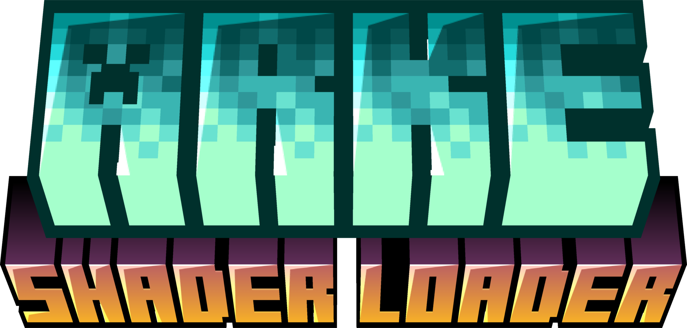
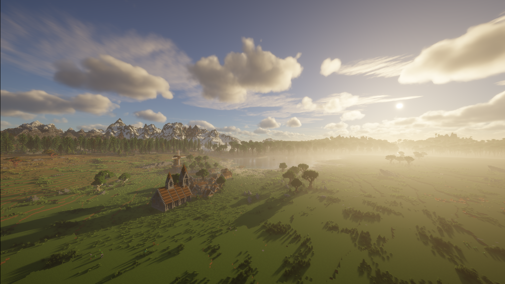
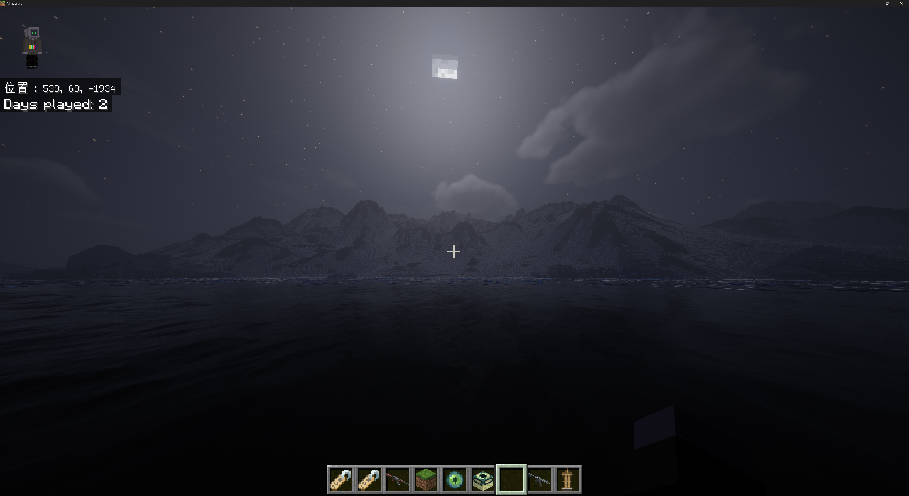
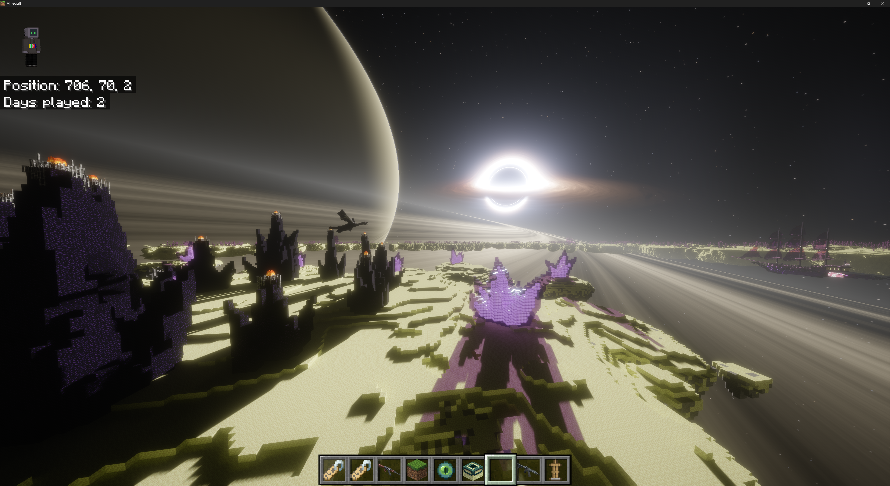

# Arke

<div align="center">

</div>

[中文](README.zh.md) | English

Arke is a LeviLamina mod for Minecraft Bedrock Edition. It runs Java Edition shader packs written for Iris and OptiFine on Bedrock's Direct3D 12 renderer with **0 Performance Loss**.

## Showcase

iterationRP shader runs on Arke:




## Macros

In addition to the Iris macros, Arke defines:

| Macro | Value |
| --- | --- |
| `IS_ARKE` | Defined when running on Arke |
| `ARKE_VERSION` | Arke version number; `100` for 0.1.0 |

To handle Bedrock differences in a shader pack:

```glsl
#ifdef IS_ARKE
    // Bedrock-specific handling
#endif
```

## Plans

- Android support
- A new HLSL-based shader format (in design)

## Reporting issues

Please include:

- Arke, game and LeviLamina versions
- GPU model and driver version
- Shader pack name, version and the options you changed
- Steps to reproduce and screenshots
- `mods\arke\logs\arke.log`
- If the shader pack fails to load, the contents of Messages in the settings window

## Third-party components

| Component | License |
| --- | --- |
| DirectX Shader Compiler (`dxcompiler.dll`) | University of Illinois/NCSA |
| glslang | BSD-3-Clause and others |
| SPIRV-Cross | Apache-2.0 |
| SPIRV-Tools | Apache-2.0 |
| Dear ImGui | MIT |
| GLM | MIT |
| JCPP | Apache-2.0 |
| JOML | MIT |
| nlohmann/json | MIT |
| miniz | MIT |
| stb | MIT or public domain |
