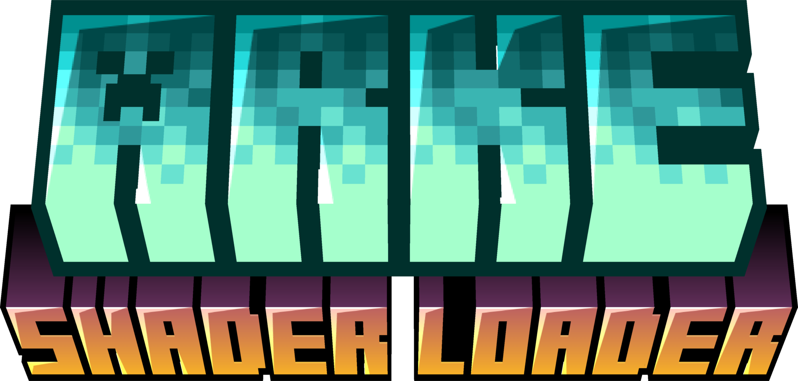
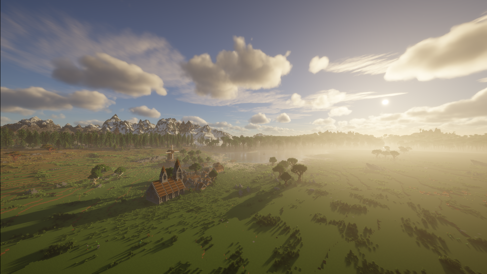
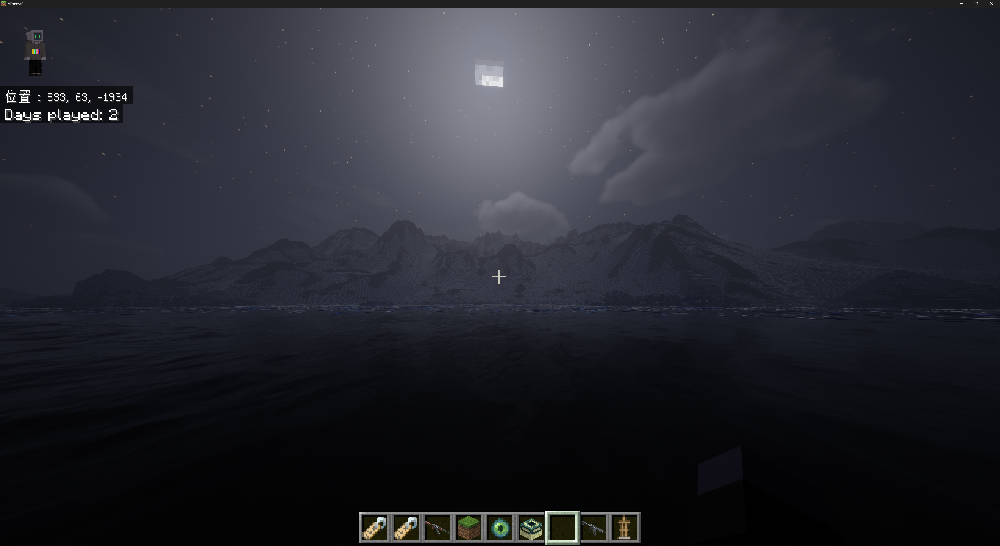
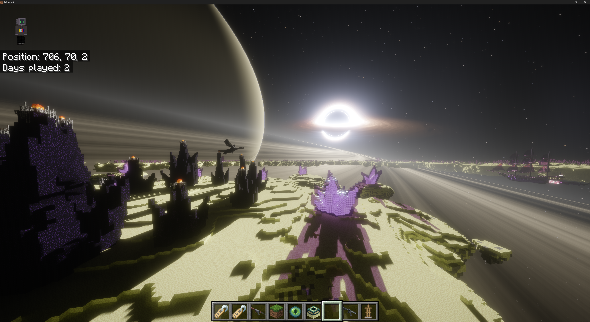

# Arke

<div align="center">

</div>

中文 | [English](README.md)

Arke 是 Minecraft 基岩版的 LeviLamina 模组，在基岩版的 Direct3D 12 渲染器上**0性能损耗**运行为 Iris 和 OptiFine 编写的 Java 版光影包。

## 展示

在Arke上运行iterationRP着色器:




## 宏

除 Iris 的宏以外，Arke 还定义：

| 宏 | 值 |
| --- | --- |
| `IS_ARKE` | 运行在 Arke 上时定义 |
| `ARKE_VERSION` | Arke 版本号，0.1.0 为 `100` |

光影包要单独处理基岩版的差异时：

```glsl
#ifdef IS_ARKE
    // 基岩版专用处理
#endif
```

## 计划

- 支持安卓平台
- 基于 HLSL 的全新光影格式（设计中）

## 反馈问题

请附上：

- Arke、游戏、LeviLamina 的版本
- 显卡型号和驱动版本
- 光影包名称、版本和改过的选项
- 复现步骤和截图
- `mods\arke\logs\arke.log`
- 光影包加载出错时，设置窗口“加载信息”里的内容

## 第三方组件

| 组件 | 许可证 |
| --- | --- |
| DirectX Shader Compiler（`dxcompiler.dll`） | University of Illinois/NCSA |
| glslang | BSD-3-Clause 等 |
| SPIRV-Cross | Apache-2.0 |
| SPIRV-Tools | Apache-2.0 |
| Dear ImGui | MIT |
| GLM | MIT |
| JCPP | Apache-2.0 |
| JOML | MIT |
| nlohmann/json | MIT |
| miniz | MIT |
| stb | MIT 或公有领域 |
